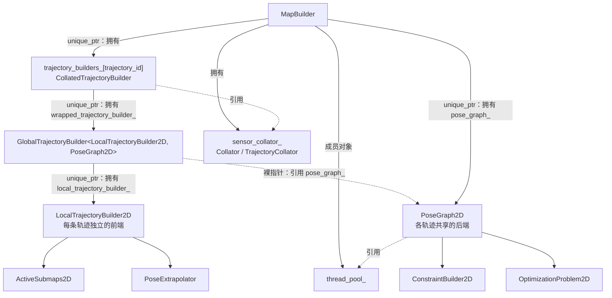
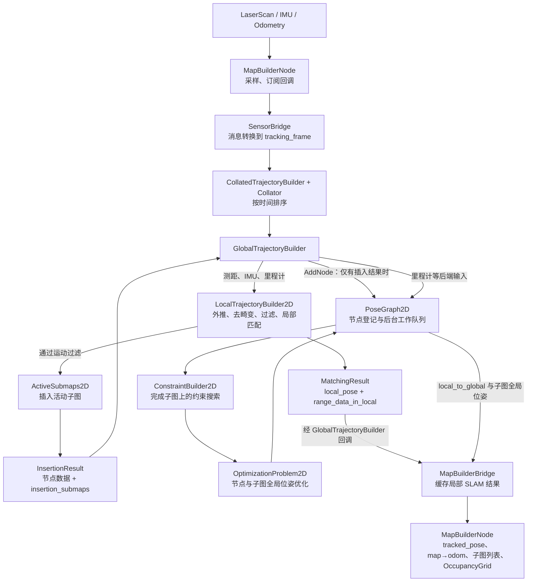
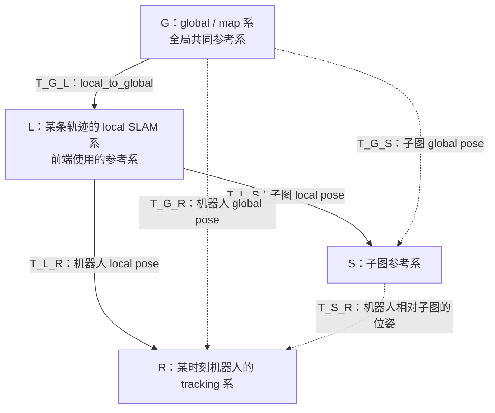
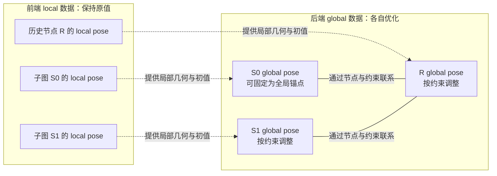

# Cartographer 2D：rf_robot_v2 中的设计与逻辑

本文以 `/home/royfan/ws/rf_robot_v2/` 中的实际源码为依据，只讨论 2D。核心库位于 `src/cartographer/`，ROS 2 集成位于 `src/rf_map_builder/`。文中的参数以仓库内 `rf_map_builder/config/default_map_builder_cfg.lua` 及其包含的 Lua 文件为准；运行时加载的是安装目录中的配置，实际部署值需要与安装文件核对。

## 第 0 章：代码结构与系统框图

### 0.1 代码目录与职责

以下路径相对于 `/home/royfan/ws/rf_robot_v2/`。核心库路径中的两层 `cartographer` 分别是源码包目录与库内部目录。

```text
src/
├── rf_map_builder/                         ROS 2 集成层
│   ├── src/map_builder_node.cc             节点、订阅、建图启停、地图与 TF 发布
│   ├── src/map_builder_bridge.cc           管理轨迹、缓存前端结果、查询后端数据
│   ├── src/sensor_bridge.cc                ROS 消息转换、传感器外参转换
│   ├── src/config_options.cc               Lua 配置加载与选项构造
│   └── config/                            本项目使用的 Cartographer 配置
└── cartographer/cartographer/             Cartographer 核心库
    ├── mapping/
    │   ├── map_builder.{h,cc}              顶层管理：轨迹、PoseGraph、线程池
    │   ├── trajectory_builder_interface.h  统一传感器入口、前端结果回调
    │   ├── trajectory_node.h              轨迹节点的不可变数据与全局位姿
    │   ├── pose_extrapolator.{h,cc}        位姿外推、速度估计、IMU 重力估计
    │   ├── 2d/
    │   │   ├── submap_2d.{h,cc}            Submap2D 与 ActiveSubmaps2D
    │   │   ├── probability_grid.*          概率栅格
    │   │   └── probability_grid_range_data_inserter_2d.*
    │   └── internal/
    │       ├── collated_trajectory_builder.* 传感器排序包装层
    │       ├── global_trajectory_builder.*   串接前端、后端与结果回调
    │       ├── motion_filter.*               控制插图与节点生成频率
    │       ├── range_data_collator.*         多路测距点云按时间区间合并
    │       ├── 2d/
    │       │   ├── local_trajectory_builder_2d.* 2D 前端主流程
    │       │   ├── pose_graph_2d.*               2D 后端调度与图管理
    │       │   └── scan_matching/               实时相关、快速相关、Ceres 匹配
    │       ├── constraints/constraint_builder_2d.* 后台扫描匹配与约束生成
    │       └── optimization/optimization_problem_2d.* 全局 Ceres 优化
    ├── sensor/
    │   ├── internal/collator.*             多种传感器按时间排序
    │   ├── internal/ordered_multi_queue.*  排序队列与等待逻辑
    │   └── internal/voxel_filter.*         点云降采样
    ├── common/                            时间、任务、线程池、采样工具
    └── io/                                状态序列化、子图纹理与地图绘制
```

### 0.2 对象关系：MapBuilder 如何串起前后端

`MapBuilder` 管理整个 SLAM 实例。每添加一条轨迹，就创建一个前端和一个 `GlobalTrajectoryBuilder`，再用 `CollatedTrajectoryBuilder` 包装后放进 `trajectory_builders_`。所有轨迹共用一个 `PoseGraph2D`，因此后端既能做单轨迹回环，也能建立跨轨迹约束。



这里的“GlobalTrajectoryBuilder 包含前端与后端”应理解为：它拥有前端，并保存后端指针，把二者连接起来；后端的所有权属于 `MapBuilder`。`GlobalTrajectoryBuilder` 本身主要是数据分发和结果转接层，全局优化实际在 `PoseGraph2D` 及其优化器中执行。

构造入口是 `MapBuilder::MapBuilder()` 与 `MapBuilder::AddTrajectoryBuilder()`：前者创建 `PoseGraph2D`、`OptimizationProblem2D` 和传感器排序器；后者调用 `CreateGlobalTrajectoryBuilder2D()`，创建对应轨迹的处理链。`GlobalTrajectoryBuilder` 是定义在 `.cc` 内的模板类，对外通过工厂函数返回 `TrajectoryBuilderInterface`。

### 0.3 系统数据流



前端在传感器数据分发的调用链中处理测距数据，目标是及时提供局部位姿，并把点云写入局部子图。它匹配的是活动子图，不会每帧对整张全局地图匹配。

后端接收前端选出的节点和插入子图，先建立子图内约束，再在已完成的子图上搜索额外约束，按条件触发全局优化。约束搜索和优化经后台线程池执行，前端无需等待每一轮全局优化结束才能继续处理数据。

### 0.4 坐标系与前后端边界

本文用 `T_A_B` 表示把 B 系坐标转换到 A 系，即 B 在 A 中的位姿。

| 坐标系/变换 | 含义 |
| --- | --- |
| `tracking_frame` | 跟踪的机器人坐标系，本项目配置为 `base_link`；输入点云、IMU 等由桥接层转到该系 |
| gravity-aligned frame | 前端根据重力方向建立的水平坐标系，在此进行 2D 点云处理与匹配 |
| local frame | 每条轨迹的局部 SLAM 坐标系；前端输出 `T_local_tracking` |
| submap frame | 子图自身的位姿参考系；其 `local_pose()` 给出 `T_local_submap` |
| global/map frame | 后端优化后的全局坐标系，本项目发布为 `map` |
| `T_map_local` | `GetLocalToGlobalTransform()` 返回的局部到全局变换 |

当前机器人全局位姿由 `T_map_tracking = T_map_local · T_local_tracking` 得到。后端优化会改变节点和子图的全局位姿，也会改变 `T_map_local`；它不会把优化位姿直接写回前端的外推器，也不会重新插入历史点云来重建每个子图的栅格。

后端各历史节点可以得到不同的位姿修正；用于当前轨迹输出的 `T_map_local` 则由该轨迹最后一个已优化子图计算。局部 SLAM 坐标系不能直接等同于 ROS 的 `odom` 坐标系。

## 第 1 章：2D 前端的设计与处理细节

### 1.1 输入整理：两层 Collator 的职责

`SensorBridge` 将 ROS 消息转换为 `TimedPointCloudData`、`ImuData`、`OdometryData`，调用 `TrajectoryBuilderInterface::AddSensorData()`。

外层 `CollatedTrajectoryBuilder` 使用 `sensor::Collator` 对不同传感器数据按时间排序，再交给 `GlobalTrajectoryBuilder`。本项目 `collate_by_trajectory = false`，使用跨轨迹统一排序的 `Collator`；设为 `true` 才使用按轨迹独立排序的 `TrajectoryCollator`。排序器需要等待预期传感器队列的数据，某路预期输入长期缺失可能阻塞分发。

前端内部还有 `RangeDataCollator`，专门把多路测距输入按时间区间整理成同步点云，保留每个点的相对时间及对应传感器原点。它与外层异构传感器排序是两个不同阶段；即使这里只有一路激光，也会经过它。

### 1.2 PoseExtrapolator：预测与去畸变的基础

`LocalTrajectoryBuilder2D` 持有 `PoseExtrapolator`，根据近期匹配位姿、IMU 和里程计预测指定时刻的位姿。

本版本的 2D 实现使用常速度外推器，`InitializeExtrapolator()` 明确检查 `pose_extrapolator.use_imu_based = false`。这个开关为 `false` 不意味着禁用 IMU：`use_imu_data = true` 时，IMU 仍参与重力方向和旋转外推；平移主要来自位姿变化或里程计速度，而不是对加速度做完整惯性导航双积分。

初始化行为如下：启用 IMU 时，由第一条 IMU 初始化外推器，此前测距输入无法生成有效结果；不启用 IMU 时，在测距数据到来时初始化。前端外推器尚未初始化时收到的里程计不会加入其中。每次匹配成功后，`extrapolator_->AddPose()` 把新的局部位姿用于后续预测。

### 1.3 AddRangeData：逐点去畸变、距离过滤与累积

测距主入口是 `LocalTrajectoryBuilder2D::AddRangeData()`。

1. 调用 `range_data_collator_.AddRangeData()`，取得同步点云；数据尚未就绪时返回空结果。
2. 根据消息参考时刻和各点相对时间，计算每个点的实际采样时刻。
3. 对每个点调用 `ExtrapolatePose(time_point)`，将对应传感器原点及测距点变换到 local 系，补偿扫描期间的机器人运动。
4. 按距离分类：小于 `min_range` 的点丢弃；不超过 `max_range` 的点进入 `returns`；超过上限的点改为长度为 `missing_data_ray_length` 的 `misses` 射线。
5. 累积到 `num_accumulated_range_data` 后，转换到当前参考时刻的重力对齐坐标系，进入下一阶段。

`returns` 是有效回波端点，可同时贡献占据与射线自由空间信息；`misses` 主要贡献自由空间信息。去畸变是在预测位姿基础上完成的，因此时间戳、每点时间、外参和外推质量都会影响匹配。

### 1.4 点云过滤与二维投影

`TransformToGravityAlignedFrameAndFilter()` 先把点云转到重力对齐坐标系，再按 `min_z`、`max_z` 裁剪高度，并对 `returns`、`misses` 做固定尺寸体素过滤。

`AddAccumulatedRangeData()` 随后对有效回波使用 `AdaptiveVoxelFilter()`，生成扫描匹配点云。自适应过滤在给定最大体素尺寸和最少点数目标之间寻找降采样尺度，降低匹配开销。

两种点云用途不同：固定体素过滤后的 `RangeData` 用于插入子图；进一步自适应过滤后的回波点云用于前端扫描匹配，并保存在后端节点数据中。本版本虽然解析了 `loop_closure_adaptive_voxel_filter` 配置，但 2D 运行路径没有单独使用它再次过滤，后端直接使用节点保存的 `filtered_gravity_aligned_point_cloud`。

### 1.5 ScanMatch：预测位姿到局部匹配位姿

先计算二维预测：`Project2D(T_local_tracking_prediction · gravity_alignment⁻¹)`，然后调用 `ScanMatch()`。

没有活动子图时，直接采用预测位姿以启动建图。已有活动子图时，匹配对象是 `active_submaps_.submaps().front()`，即较老的活动子图。

匹配流程为：可选的 `RealTimeCorrelativeScanMatcher2D` 粗搜索，然后 `CeresScanMatcher2D` 连续优化。本项目默认关闭在线相关匹配，直接用预测位姿初始化 Ceres。这里的实时相关匹配器与后端使用的快速相关匹配器是不同实现。

Ceres 优化变量是当前扫描的 `(x, y, yaw)`，目标函数包含三个部分：点云与栅格的占据匹配残差、偏离预测平移的残差、偏离初始旋转的残差。开启在线相关匹配后，Ceres 初值与旋转参考来自相关匹配结果，平移参考仍使用原预测位姿。

匹配得到二维位姿后，重新乘上重力对齐旋转，形成 `pose_estimate = Embed3D(pose_estimate_2d) · gravity_alignment`，再更新外推器。接口保留三维刚体变换形式，但扫描匹配优化的自由度仍是平面三个自由度。

### 1.6 MotionFilter：匹配与插入分开

每次有效局部匹配都会产生 `MatchingResult`，但不一定产生 `InsertionResult`。

`InsertIntoSubmap()` 首先调用 `motion_filter_.IsSimilar()`。相对上一次保留数据，时间差、平移距离和旋转角度都不超过阈值时，认为运动相似，跳过插图；任一阈值被超过则保留，第一次也会保留。

运动过滤发生在匹配与外推器更新之后，所以被过滤的扫描仍可以更新局部位姿、触发局部结果回调。它只是不更新子图，也不创建新的后端节点。后端节点数因此不能直接按激光帧数计算。

### 1.7 ActiveSubmaps2D：重叠子图与栅格更新

`ActiveSubmaps2D::InsertRangeData()` 最多维护两个活动子图，每次保留的测距数据插入当前所有活动子图。

设 `N = submaps.num_range_data`：第一个子图收到 N 次插入后，下一次插入前创建第二个子图；随后新数据同时插入两者。较老子图累计收到 `2N` 次插入后调用 `Finish()`，裁剪栅格并标记 `insertion_finished`；下一次创建新子图时移出活动集合。完成子图仍由后端通过共享指针保存。

本项目 N = 90，因此正常连续建图时每个完整子图接收 180 次插入，相邻子图重叠 90 次。这里计数的是通过运动过滤后的插入次数。

默认使用 `ProbabilityGrid`，分辨率 0.05 m。有效回波端点提高占据概率，射线经过的自由区域降低占据概率；更新采用概率对应的 odds 更新及查表机制，并限制同一轮插入对单元格的重复更新。`hit_probability = 0.55`、`miss_probability = 0.49` 是更新参数，不是把格子直接赋值为这两个概率。

子图栅格记录局部几何；后端优化调整的是子图的全局摆放位姿。完成子图的栅格不再继续插入，适合缓存后端相关匹配的预计算结构。

### 1.8 前端结果如何进入后端

`MatchingResult` 包含时刻、局部位姿、local 系测距数据，以及可为空的 `InsertionResult`。插入结果包含共享的不可变节点数据和本次插入的一到两个子图。

`TrajectoryNode::Data` 中与 2D 相关的主要字段是 `time`、`gravity_alignment`、`filtered_gravity_aligned_point_cloud` 和 `local_pose`。

`GlobalTrajectoryBuilder` 收到匹配结果后，仅在插入结果存在时调用 `pose_graph_->AddNode()`，取得 `NodeId`。随后调用 `local_slam_result_callback_`，回传匹配结果；本项目桥接层缓存局部位姿与点云，用于发布。

## 第 2 章：2D 后端的设计与处理细节

### 2.1 PoseGraph2D 管理什么

`PoseGraph2D` 保存轨迹节点、子图、约束、轨迹状态、轨迹连通关系与优化后的子图位姿，并管理后台工作队列。

| 对象 | 后端中的意义 |
| --- | --- |
| `NodeId{trajectory_id, node_index}` | 一次通过运动过滤的前端插入对应的轨迹节点 |
| `SubmapId{trajectory_id, submap_index}` | 子图的唯一标识 |
| `TrajectoryNode` | 不可变的前端数据 `constant_data`，加可更新的 `global_pose` |
| `InternalSubmapData` | 子图引用、参与插入的节点集合、约束搜索状态 |
| `Constraint` | 子图与节点的相对位姿测量、平移/旋转权重、约束类型 |
| `OptimizationProblem2D` | 求解器使用的节点、子图变量以及里程计等辅助数据 |

位姿图不是单纯把所有扫描按顺序连接起来：核心约束连接“子图—节点”，另外还有相邻节点间的局部 SLAM 相对位姿与里程计残差。

### 2.2 AddNode：前台登记，后台处理

`PoseGraph2D::AddNode()` 先用当前 `T_map_local · local_pose` 给节点初始化全局位姿。`AppendNode()` 登记节点，为首次出现的插入子图分配 ID；随后将 `ComputeConstraintsForNode()` 放入工作队列并返回 `NodeId`。

后台处理时，`InitializeGlobalSubmapPoses()` 创建必要的子图优化变量。新子图的全局初值根据已有子图的全局位姿与二者在 local 系中的相对关系推导。节点优化初值也基于匹配子图的当前全局位姿计算。

此时返回的 `NodeId` 只表示节点已登记，不表示回环搜索或全局优化已完成。

### 2.3 两种子图—节点约束

`ComputeConstraintsForNode()` 首先为节点与每个插入子图建立 `INTRA_SUBMAP` 约束，其测量为 `T_submap_node = T_local_submap⁻¹ · T_local_node`，使用 `matcher_translation_weight`、`matcher_rotation_weight`。

这类约束由前端的插入关系直接产生，不需要再进行一次后端扫描匹配。

`INTER_SUBMAP` 约束由后端将节点点云与它未参与插入的完成子图进行匹配产生，使用 `loop_closure_translation_weight`、`loop_closure_rotation_weight`。它可以连接同一轨迹的不同子图，也可以连接不同轨迹；约束类型不能直接按轨迹是否相同来判断。

搜索有两个方向：新节点与此前完成子图匹配；某个子图刚完成时，再将未插入过该子图的已有节点与它匹配。这样既覆盖新节点对旧地图，也覆盖新完成地图对旧节点。

### 2.4 候选搜索：局部窗口与全子图搜索

`PoseGraph2D::ComputeConstraint()` 根据轨迹关系选择搜索方式：同一轨迹，或两条轨迹最近有过有效连接时，采用带初值的局部窗口搜索；不同轨迹且超过最近连接时间窗口时，通过 `global_sampling_ratio` 采样后尝试全子图搜索。

局部窗口路径调用 `ConstraintBuilder2D::MaybeAddConstraint()`，还会按 `max_constraint_distance` 限制初始相对平移，并使用每个子图的 `sampling_ratio` 采样器减少候选计算。

全子图路径调用 `MaybeAddGlobalConstraint()`，不依赖准确的相对位姿初值，也不经过上述局部距离过滤与每子图采样分支。这里的“global”指在候选子图上做全范围匹配，不能理解为一次函数调用就直接匹配整张拼接地图。

### 2.5 ConstraintBuilder2D：快速相关匹配与精修

`ConstraintBuilder2D` 对完成子图缓存 `FastCorrelativeScanMatcher2D`。其预计算栅格为不同搜索尺度提供分数上界，使用分支定界搜索平移和旋转候选，减少需要展开的计算。

约束生成分三步：快速相关匹配寻找候选；分数必须超过局部 `min_score` 或全子图 `global_localization_min_score`；通过后用后端自己的 `CeresScanMatcher2D` 精修，再转换成子图—节点相对位姿，生成 `INTER_SUBMAP` 约束。

匹配任务依赖对应子图匹配器的构造任务，通过线程池调度。`NotifyEndOfNode()` 汇总当前节点约束任务的依赖；`WhenDone()` 在本批任务全部结束后回传成功约束。搜索失败的候选不会进入位姿图。

### 2.6 优化触发与后台工作队列

`AddWorkItem()` 按顺序添加后端工作，`DrainWorkQueue()` 连续执行，直到某个工作项返回 `kRunOptimization`。此时暂停继续消费工作队列，调用 `constraint_builder_.WhenDone()` 等待本批约束完成。

回调进入 `HandleWorkQueue()` 后，依次合并约束、运行优化、更新轨迹连通关系、执行必要的裁剪、重置节点计数，再继续处理队列。前端仍可以登记新节点并排队；后台图修改和求解按这个批次顺序组织。

常规优化由 `optimize_every_n_nodes` 控制。本项目配置值为 120，但本版本源码判断为 `num_nodes_since_last_loop_closure_ > optimize_every_n_nodes`，因此常规条件在计数达到 121 时触发。计数对象是后端节点，且这不是唯一触发来源：结束轨迹、最终优化等也能请求优化。配置为 0 会关闭这一周期触发条件。

### 2.7 OptimizationProblem2D：变量、残差与求解

`OptimizationProblem2D::Solve()` 以节点和子图的全局平面位姿 `(x, y, yaw)` 为主要变量。固定第一个子图消除整体平移与旋转的自由度；冻结轨迹的节点和子图也保持固定。

求解包含以下残差：

- 子图—节点残差：使预测相对位姿 `T_map_submap⁻¹ · T_map_node` 接近约束测量；`INTER_SUBMAP` 使用 Huber 鲁棒损失，`INTRA_SUBMAP` 不使用该损失。
- 相邻节点的局部 SLAM 相对位姿残差：保留前端局部运动关系，使用 `local_slam_pose_translation_weight` 和 `local_slam_pose_rotation_weight`。
- 相邻节点的里程计相对位姿残差：在有覆盖节点时刻的里程计数据时，通过插值构造，使用 odometry 权重。
- 可选的 landmark 与 fixed-frame pose 残差：有相应观测才参与；本项目默认关闭这两类输入。

本版本即使有里程计，也仍添加相邻节点的局部 SLAM 相对位姿残差；不能简单描述成“有里程计就替代前端位姿约束”。被裁剪后节点索引不连续的相邻记录不会建立上述连续节点残差。

虽然 `GlobalTrajectoryBuilder` 会把 IMU 送到后端接口，`OptimizationProblem2D::AddImuData()` 的实现是空操作，明确不使用 IMU 做 2D 全局优化。因此 2D 的 IMU 作用主要在前端；配置中通用的 IMU 加速度、旋转权重不能据此认为在该 2D 求解中生效。

Ceres 在这些约束之间求折中，而不是只修改当前位姿。检测到可靠回环后，历史节点与子图的全局位姿也会改变，从而减少累计漂移。

### 2.8 优化结果如何更新全局地图与当前位姿

`PoseGraph2D::RunOptimization()` 求解后更新各节点 `global_pose` 和 `global_submap_poses_2d`，节点的重力对齐旋转会重新组合到三维接口位姿中。

当前轨迹的局部到全局变换通过最后一个已优化子图计算：`T_map_local = T_map_submap · T_local_submap⁻¹`。尚未进入当前优化批次的新节点，则使用新旧 local-to-global 变换之间的差值修正其全局位姿。

`MapBuilderBridge::getLocalTrajectoryData()` 把缓存的局部 SLAM 结果与最新后端 `local_to_map` 放在一起。`MapBuilderNode::publishLocalTrajectoryData()` 使用发布层自己的外推器得到当前 `T_local_tracking`，组合为 `T_map_tracking`。这个发布层外推器与前端内部外推器是两个对象。

项目再查询 `T_tracking_odom`，发布 `T_map_odom = T_map_tracking · T_tracking_odom`。后端优化改变 `T_map_local` 后，当前全局位姿和 `map→odom` 也会随之修正。

发布 OccupancyGrid 时，桥接层取得各子图纹理与全局位姿，节点调用 `io::PaintSubmapSlices()` 拼接，再转换成 ROS 地图消息。最终地图来自子图在优化位姿下的绘制组合，不是前端始终维护的一张单体全局概率栅格。

### 2.9 轨迹结束与最终优化

`MapBuilder::FinishTrajectory()` 先结束传感器排序器中的该轨迹，再通知 PoseGraph。后端把轨迹状态改为 `FINISHED` 并请求优化。

`PoseGraph2D::RunFinalOptimization()` 临时将迭代上限设为 `max_num_final_iterations`，请求优化，再恢复常规迭代上限，并等待后台计算完成。

本项目 `MapBuilderNode::stopBuild()` 的顺序是 `FinishTrajectory()` → `runFinalOptimization()` → 发布最终 OccupancyGrid → 清除当前活动轨迹标记。停止建图会等待这一收尾流程。

## 第 3 章：项目配置与源码阅读索引

### 3.1 仓库默认配置的关键值

以下是 `src/rf_map_builder/config/` 中主配置覆盖基础配置后得到的值。

| 配置项 | 值 | 对应行为 |
| --- | --- | --- |
| `use_trajectory_builder_2d` | `true` | 创建 2D 前端与 PoseGraph2D |
| `num_background_threads` | 4 | 后端工作与约束任务的线程池规模 |
| `collate_by_trajectory` | `false` | 使用统一 Collator |
| `tracking_frame / map_frame / odom_frame` | `base_link / map / odom` | 输入转换与发布坐标系 |
| `num_laser_scans / num_point_clouds` | 1 / 0 | 默认一路激光扫描 |
| `use_imu_data / use_odometry` | `true / true` | IMU 辅助前端；里程计参与前端与后端 |
| `pose_extrapolator.use_imu_based` | `false` | 使用常速度外推器，仍可融合 IMU 旋转信息 |
| `min_range / max_range` | 0.12 / 10.0 m | 距离过滤范围 |
| `missing_data_ray_length` | 5.0 m | 超量程回波转换出的 misses 长度 |
| `num_accumulated_range_data` | 1 | 一次同步测距输出即可进入匹配 |
| `voxel_filter_size` | 0.025 m | 插图点云的固定体素降采样 |
| `use_online_correlative_scan_matching` | `false` | 前端默认直接 Ceres 匹配 |
| `motion_filter` 时间/距离/角度 | 5 s / 0.2 m / 1° | 全部不超过时跳过插图 |
| `submaps.num_range_data` | 90 | 子图创建间隔；完整子图接收 180 次插入 |
| 子图类型/分辨率 | ProbabilityGrid / 0.05 m | 概率栅格局部地图 |
| `optimize_every_n_nodes` | 120 | 本版本常规计数超过 120 时请求优化 |
| `constraint_builder.sampling_ratio` | 0.3 | 局部约束候选的每子图采样比例 |
| `max_constraint_distance` | 10 m | 局部约束候选的初始距离上限 |
| `min_score / global_localization_min_score` | 0.6 / 0.65 | 后端局部/全子图相关匹配门槛 |
| 后端相关搜索平移/角度窗口 | 7 m / 30° | 局部窗口搜索范围 |
| `global_sampling_ratio` | 0.003 | 跨轨迹全子图搜索的采样比例 |
| `global_constraint_search_after_n_seconds` | 10 s | 跨轨迹最近连接的时间窗口 |
| 常规/最终优化迭代上限 | 50 / 200 | 全局 Ceres 求解迭代预算 |

配置读取入口在 `MapBuilderNode` 构造函数：搜索 `rf_map_builder` 的安装 share/config 目录和用户 `.rf_robot/config` 目录，加载 `default_map_builder_cfg.lua`。因此修改源码目录的配置后，还需要关注安装目录中的实际文件。

默认启用 IMU 时，项目 `SensorBridge::toImuData()` 要求 IMU 到 tracking 系的平移近似为零，并检查加速度、角速度可用；不符合时丢弃消息。这会影响外层排序器是否持续收到预期 IMU，以及前端能否初始化。

### 3.2 推荐的源码阅读顺序

以下链接指向本机项目源码，函数名是主要定位依据。

1. [map_builder_node.cc](/home/royfan/ws/rf_robot_v2/src/rf_map_builder/src/map_builder_node.cc)：构造、`startBuild()`、`stopBuild()`、发布逻辑。
2. [map_builder_bridge.cc](/home/royfan/ws/rf_robot_v2/src/rf_map_builder/src/map_builder_bridge.cc) 与 [sensor_bridge.cc](/home/royfan/ws/rf_robot_v2/src/rf_map_builder/src/sensor_bridge.cc)：轨迹建立、回调缓存、输入转换。
3. [map_builder.cc](/home/royfan/ws/rf_robot_v2/src/cartographer/cartographer/mapping/map_builder.cc)：`MapBuilder()`、`AddTrajectoryBuilder()`，确认对象组装和共享后端。
4. [collated_trajectory_builder.cc](/home/royfan/ws/rf_robot_v2/src/cartographer/cartographer/mapping/internal/collated_trajectory_builder.cc) 与 [global_trajectory_builder.cc](/home/royfan/ws/rf_robot_v2/src/cartographer/cartographer/mapping/internal/global_trajectory_builder.cc)：传感器排序、分发、局部结果到 `AddNode()` 的桥接。
5. [local_trajectory_builder_2d.cc](/home/royfan/ws/rf_robot_v2/src/cartographer/cartographer/mapping/internal/2d/local_trajectory_builder_2d.cc)：`AddRangeData()` → `AddAccumulatedRangeData()` → `ScanMatch()` → `InsertIntoSubmap()`。
6. [pose_extrapolator.cc](/home/royfan/ws/rf_robot_v2/src/cartographer/cartographer/mapping/pose_extrapolator.cc)、[motion_filter.cc](/home/royfan/ws/rf_robot_v2/src/cartographer/cartographer/mapping/internal/motion_filter.cc)、[submap_2d.cc](/home/royfan/ws/rf_robot_v2/src/cartographer/cartographer/mapping/2d/submap_2d.cc)：预测、节点选择、重叠子图生命周期。
7. [pose_graph_2d.cc](/home/royfan/ws/rf_robot_v2/src/cartographer/cartographer/mapping/internal/2d/pose_graph_2d.cc)：`AddNode()`、`ComputeConstraintsForNode()`、`ComputeConstraint()`、`DrainWorkQueue()`、`RunOptimization()`。
8. [constraint_builder_2d.cc](/home/royfan/ws/rf_robot_v2/src/cartographer/cartographer/mapping/internal/constraints/constraint_builder_2d.cc)：候选筛选、匹配器缓存、任务依赖与约束构造。
9. [optimization_problem_2d.cc](/home/royfan/ws/rf_robot_v2/src/cartographer/cartographer/mapping/internal/optimization/optimization_problem_2d.cc)：`Solve()`，核对变量固定方式、各类残差和传感器数据的实际使用。
10. [default_map_builder_cfg.lua](/home/royfan/ws/rf_robot_v2/src/rf_map_builder/config/default_map_builder_cfg.lua)、[trajectory_builder_2d.lua](/home/royfan/ws/rf_robot_v2/src/rf_map_builder/config/trajectory_builder_2d.lua)、[pose_graph.lua](/home/royfan/ws/rf_robot_v2/src/rf_map_builder/config/pose_graph.lua)：对照前端、后端配置与参数覆盖关系。

## 附录 A：机器人与 Submap 的 Local Pose、Global Pose

### A.1 先区分“谁的位姿”与“相对谁的位姿”

Pose 表示一个坐标系相对于另一个坐标系的位置和朝向。机器人与子图都有自己的坐标系，所以二者都可以有 local pose 和 global pose。

这里统一使用 `T_A_B`：表示 **B 系在 A 系中的位姿**，同时也是把 B 系中的点转换到 A 系的变换，即 `p_A = T_A_B · p_B`。二维情况下，一个 pose 可以写成 `(x, y, θ)`；组合时需要进行旋转和平移运算，不能直接把三个数逐项相加。

下面用 L 表示一条轨迹的 local SLAM 系，G 表示 global/map 系，R 表示某一时刻机器人的 tracking 系，S 表示某个子图的参考系。

| 对象 | Local pose | Global pose |
| --- | --- | --- |
| 机器人 R | `T_L_R`：机器人在该轨迹 local 系中的位置与朝向 | `T_G_R`：机器人在全局 map 系中的位置与朝向 |
| 子图 S | `T_L_S`：子图参考系在该轨迹 local 系中的位置与朝向 | `T_G_S`：子图参考系在全局 map 系中的位置与朝向 |

“Local”在这里始终指轨迹的 local SLAM 系，**机器人的 local pose 不是机器人相对子图的位姿**。机器人相对子图的位姿另记为 `T_S_R`。

### A.2 坐标系关系图：四种 Pose 放在哪里

图中的箭头表示“从父参考系观察子坐标系”，标签是子坐标系在父系中的 pose；对点坐标应用变换时，则从子系转换到父系。



在尚未经过独立全局修正、或用某个子图作为当前局部到全局的锚点时，关系为：

```text
机器人相对子图：T_S_R = inverse(T_L_S) · T_L_R
子图放入全局：  T_G_S = T_G_L · T_L_S
机器人放入全局：T_G_R = T_G_L · T_L_R
                     = T_G_S · T_S_R
```

第一式描述前端提供的局部相对关系；后两式描述如何根据一个全局摆放变换，把局部结果放到全局系中。全局优化后，历史节点和各子图是独立优化变量，不能假定一个统一的 `T_G_L` 仍能精确复现所有历史 global pose，详见 A.6。

### A.3 机器人的 Local Pose 与 Global Pose

机器人 local pose 由前端根据外推和扫描匹配产生。当前一帧结果中的 `MatchingResult::local_pose` 表示 `T_L_R`；若这一帧被保留为后端节点，它还会进入 `TrajectoryNode::Data::local_pose`。

这个 local 系在一条轨迹内持续使用。创建下一张子图时，机器人的 local pose 不会因此清零或切换为“相对新子图”的 pose。前端会积累漂移，但其历史节点的 local pose 作为不可变数据保留下来。

机器人的 global pose 有两个需要区分的使用场景：

- **历史节点**：`TrajectoryNode::global_pose` 保存后端维护的 `T_G_R`。节点刚加入时，用当前 `T_G_L · T_L_R` 初始化；参加全局优化后，改为该节点自身的优化结果。
- **当前机器人输出**：发布层使用最新 `T_G_L` 乘当前外推的 `T_L_R`，得到当前的 `T_G_R`。它可以位于两个扫描节点之间，不要求此时刚好创建一个后端节点。

所以，回环后历史机器人节点的 global pose 可以变化，而其保存的 local pose 保持原值。当前发布的机器人全局位姿也会随新的 `T_G_L` 修正。

### A.4 Submap 的 Local Pose 与 Global Pose

一个子图可以理解为一块局部地图及其参考坐标系 S。`Submap::local_pose()` 返回 `T_L_S`，表示这块地图的参考系最初放在 local 系的什么位置。

本项目 2D 创建子图时，`ActiveSubmaps2D::AddSubmap()` 使用当前测距原点的二维位置创建子图；`Submap2D` 构造函数将 local pose 设为 `(origin.x, origin.y, 0)` 的平移，旋转为单位旋转。因此，**新子图的朝向并不直接复制机器人当时的 yaw**，其 local 参考轴与轨迹 local 系对齐。测距原点可能带有激光相对 tracking 系的安装偏移，所以子图原点也不必与机器人中心完全重合。

子图创建后，`local_pose()` 保持固定；活动期间变化的是栅格内容和插入计数。随着机器人运动，子图相对 local 系的位置不会跟着机器人移动。

子图 global pose `T_G_S` 由后端管理，可以在全局优化时改变。它保存在后端的子图位姿数据中，通过 `GetSubmapData()`、`GetAllSubmapPoses()` 等接口查询；`Submap2D` 对象自身并不保存一份可优化的 global pose。

还有一个实现细节：此版本的前端将 `range_data_in_local` 直接插入子图，栅格的坐标限界使用轨迹 local 坐标数值。因此“子图参考系”是表达子图位姿和约束的参考系，不能据此推断底层每个栅格索引都已转换成以子图原点为零的坐标。地图绘制和约束匹配会结合 `local_pose()` 处理这种关系。

### A.5 一个数值例子：同一局部几何如何摆到全局地图

为突出坐标关系，假设机器人水平、激光原点与机器人中心重合。前端 local 系中，子图原点为 `(10, 0)`，机器人位于 `(12, 1)`、yaw 为 30°。

```text
前端 local 系 L：

       y_L
        ↑
    1   |                          R：机器人 (12, 1, 30°)
        |                         ↗
    0   O_L ───────────────── S ─────────────────→ x_L
                           (10, 0)

T_L_S = (10, 0, 0°)
T_L_R = (12, 1, 30°)
T_S_R = ( 2, 1, 30°)
```

假设后端将这个子图放到全局位置 `(20, 5)`，并将它旋转 90°，即 `T_G_S = (20, 5, 90°)`。以该子图作为锚点，则：

```text
T_G_L = T_G_S · inverse(T_L_S) = (20, -5, 90°)
T_G_R = T_G_S · T_S_R         = (19,  7, 120°)
```

机器人相对子图的局部偏移 `(2, 1)` 经过 90° 旋转变成 `(-1, 2)`，再加上子图全局位置 `(20, 5)`，所以机器人全局位置是 `(19, 7)`。

```text
全局 map 系 G 中的摆放：

       y_G
        ↑
    7   |                   R (19, 7)，朝向 120°
        |                  ↖
    5   |                    S (20, 5)
        |                    ↑ 子图 x_S 轴：全局中朝向 90°
        |
        O_G ─────────────────────────────────────→ x_G
```

若后端之后仅将这个锚点子图的全局位置平移为 `(21, 5)`、旋转保持 90°，当前机器人通过该锚点计算的全局位置会变成 `(20, 7)`。前端仍保留 `T_L_S = (10, 0, 0°)` 和 `T_L_R = (12, 1, 30°)`；子图内部栅格也无需重新插入。

### A.6 为什么回环后不能用一个变换还原所有历史 Pose

全局优化会同时调整多个子图和历史节点，而且不同位置的漂移修正可以不同。例如，起点附近几乎不动，远处走廊旋转一点，回到起点的节点再向起点靠拢。这样的修正无法全部用一个刚体变换表达。



因此需要区分三种关系：

1. **前端保存的相对测量**：`inverse(T_L_S) · T_L_R`。对于插入子图，这构成子图内约束；后端为非插入子图另外匹配得到子图间约束。
2. **后端优化后的相对位姿**：`inverse(T_G_S) · T_G_R`。优化让它尽量接近对应约束测量，但由于存在其他约束与权重，残差可以非零。
3. **当前输出的局部到全局变换**：源码从该轨迹最后一个已优化子图 S_k 计算 `T_G_L = T_G_Sk · inverse(T_L_Sk)`，用于把当前前端位姿放到全局地图。它精确对应这个锚点子图，但不保证精确对应所有历史节点与子图。

前端结果提供稳定的局部几何，后端用各节点、各子图的 global pose 表达全局修正，当前机器人输出再通过最后一个已优化子图取得最新的全局对齐关系。

### A.7 对照源码时应查看哪些字段

| 想查看的量 | 源码字段或接口 | 是否会被后端优化改写 |
| --- | --- | --- |
| 某次局部匹配的机器人 local pose | `LocalTrajectoryBuilder2D::MatchingResult::local_pose` | 该次结果不会被回写 |
| 历史节点的机器人 local pose | `TrajectoryNode::constant_data->local_pose` | 不会，属于不可变前端数据 |
| 历史节点的机器人 global pose | `TrajectoryNode::global_pose` | 会，参加优化后更新 |
| 子图 local pose | `Submap::local_pose()` | 不会，创建后固定 |
| 子图 global pose | `PoseGraph2D` 的子图全局位姿，或 `GetSubmapData().pose` | 会；冻结轨迹等固定变量除外 |
| 当前轨迹 local-to-global | `GetLocalToGlobalTransform(trajectory_id)` | 根据最新已优化子图重新计算 |
| 当前发布的机器人 global pose | `local_to_map * tracking_to_local` | 随前端运动与后端对齐结果变化 |

这里使用 R 表示完整 tracking 位姿。后端 2D 优化时，还会先去除节点的 `gravity_alignment`，以水平的 `(x, y, yaw)` 建立约束与求解，输出时再把重力对齐旋转组合回去。机器人水平时，上面的二维关系可以直接使用。
